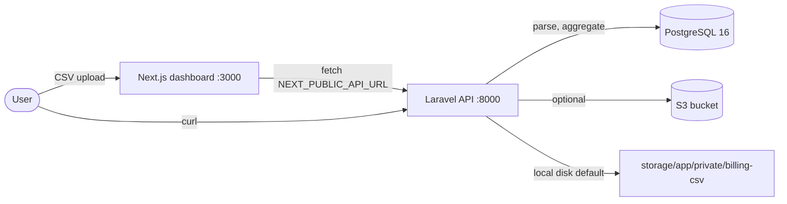
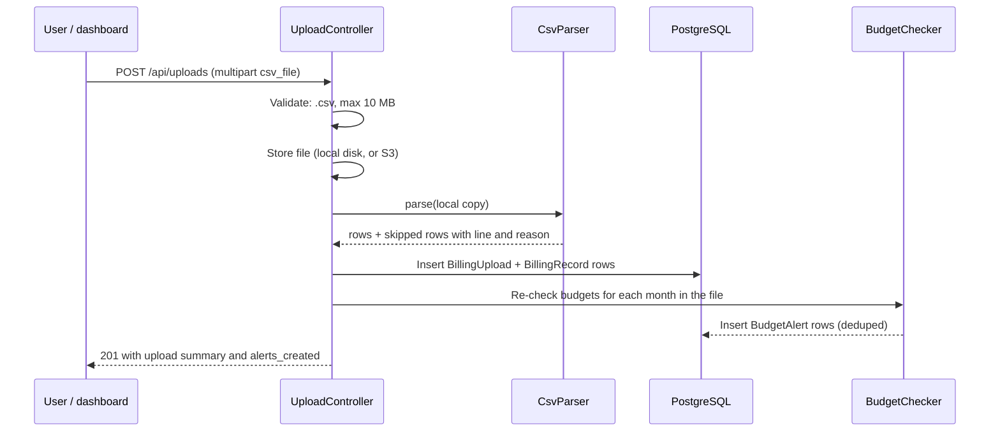
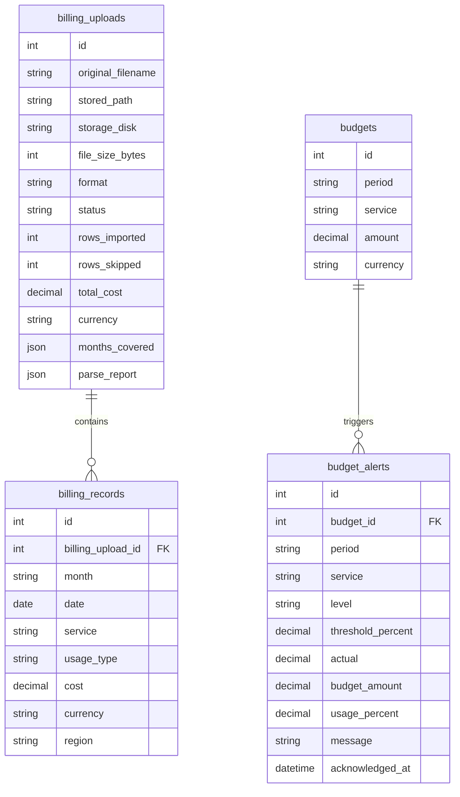

# Architecture

This document describes how Cloud Cost Tracker is put together. For the
CSV format and the endpoint table, see `docs/api.md`. For the original
short data-flow notes, see `docs/ARCHITECTURE.md`.

## Overview

The project is two applications plus a database:

- **Laravel 11 API** (`backend/`): accepts billing CSV uploads, parses and
  stores them, computes reports, manages budgets, and creates alerts.
- **Next.js 14 dashboard** (`frontend/`): four pages that call the API from
  the browser. It holds no billing data itself.
- **PostgreSQL 16** (`postgres` service in Docker Compose): the only
  persistent store.

## Upload flow

Key points:

- A bad row never fails the whole upload. It is skipped and listed in the
  upload's parse report with its line number and reason.
- Files are capped at 10 MB and 100,000 rows (`CsvParser::MAX_FILE_SIZE_BYTES`
  and `MAX_ROWS`).
- Budget re-checks run after every upload and on demand via
  `POST /api/alerts/check`. An alert is only created when no unacknowledged
  alert at the same level already exists for that budget and period, so
  re-uploads do not create duplicates.

## Core classes

The three service classes are framework-free: they take plain arrays and
return plain arrays, with no Laravel dependencies. That is why the
standalone script `backend/scripts/verify-sample.php` can exercise them
without Composer or a database.

| Class | Responsibility |
| --- | --- |
| `App\Services\CsvParser` | CSV format detection (AWS CUR or simple), row parsing and validation, ProductCode to service normalisation, malformed-row reporting. |
| `App\Services\CostAnalyzer` | Monthly totals, per-service breakdown with share percent, top services, month-over-month comparison, trends and increasing-cost detection. |
| `App\Services\BudgetChecker` | Budget evaluation: usage percent, status (`ok`, `warning`, `exceeded`), and alert creation at the 80% and 100% thresholds. |
| `UploadController` | Upload validation, file storage, parse to persist, budget re-check after each upload. |
| `ReportController` | `GET /api/reports/monthly`, `/compare`, `/trends`. |
| `BudgetController` | Budget CRUD, with live actual spend, usage percent, and status attached to each budget. |
| `AlertController` | Alert listing with filters, on-demand re-check, acknowledge. |

## Data model

- `billing_records` is indexed on `(month, service)` and on `month`.
- `budgets.service` is null for an overall monthly budget, or a service
  name such as `EC2` for a per-service budget. One budget per
  (period, service) pair; creating a duplicate returns 422.
- `budget_alerts.level` is `warning` (80% by default) or `exceeded`
  (100% by default). Thresholds are configurable; see the README.

## Configuration

Behaviour is driven by environment variables, read in
`backend/config/cost-tracker.php` and `backend/config/filesystems.php`:

| Variable | Default | Purpose |
| --- | --- | --- |
| `FILESYSTEM_DISK` | `local` | Where uploaded CSVs are stored. Set to `s3` for S3. |
| `COST_INCREASE_THRESHOLD_PERCENT` | `20` | Month-over-month rise percent that flags a service. |
| `BUDGET_WARNING_THRESHOLD` | `0.80` | Fraction of a budget that triggers a warning alert. |
| `BUDGET_EXCEEDED_THRESHOLD` | `1.00` | Fraction of a budget that triggers an exceeded alert. |
| `NEXT_PUBLIC_API_URL` | `http://localhost:8000/api` | How the dashboard reaches the API. |

With `FILESYSTEM_DISK=s3`, uploads are stored in S3 and parsing still runs
against a local temp copy, so the rest of the application is unchanged.
No AWS credentials are needed when the disk is `local`.

## Deliberate limits (v0.1.0)

- Manual CSV uploads only. There is no live AWS Cost Explorer or CUR
  delivery integration, and no scheduled sync.
- Single-user, no authentication on the API. Add authentication before
  exposing the API beyond localhost.
- No email or webhook delivery for alerts. Alerts are database records,
  listed and acknowledged in the dashboard.
- One currency per upload is assumed in the upload summary. Multi-currency
  files keep per-row currency, but totals mix currencies. The sample data
  is all USD.
- The dashboard calls the API directly from the browser, so the API must
  be reachable from the browser, not only from the dashboard server.
